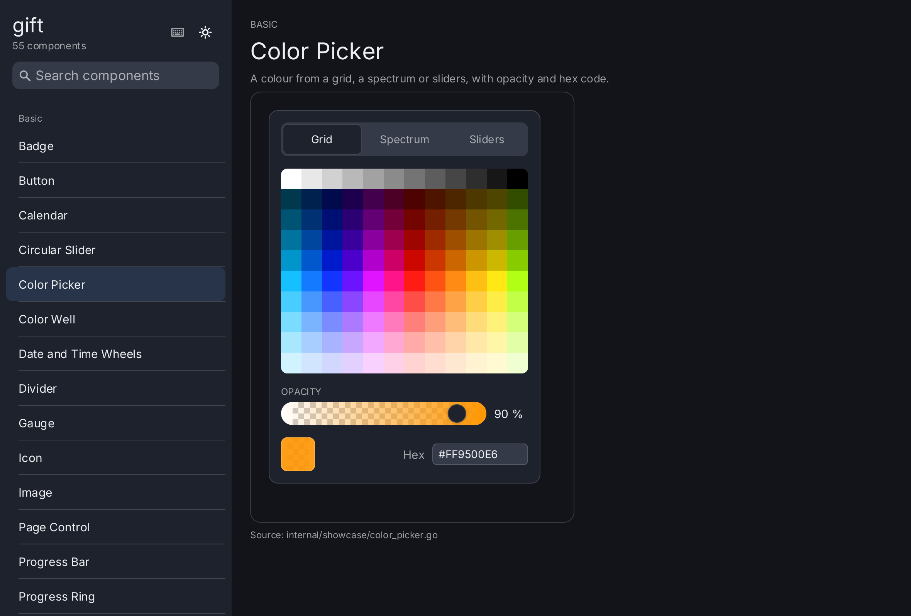
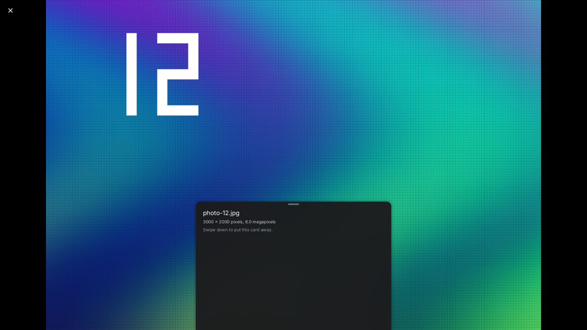
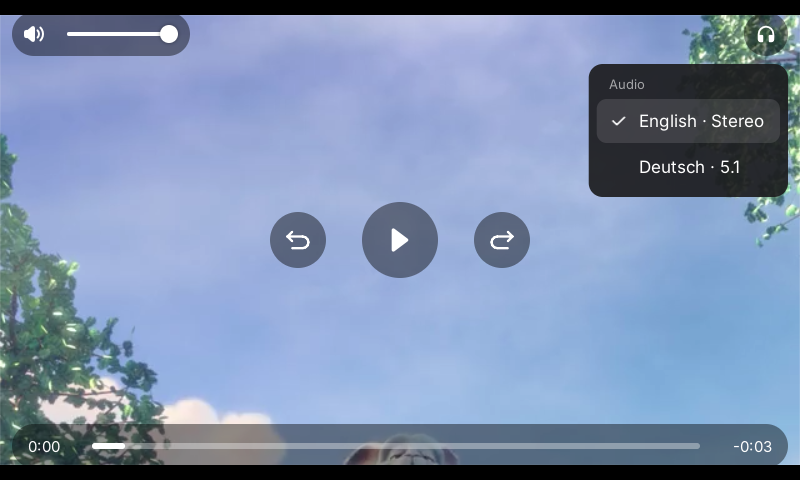

# Gift

Gift is a declarative UI toolkit for Go: SwiftUI-style views, typed state and
GPU rendering with [Ebitengine](https://ebitengine.org/), without a browser or
WebView. It focuses on desktop and touchscreen kiosk applications, particularly
on Raspberry Pi 4 and 5.

## Why?

Go applications should be able to describe their interfaces directly in Go,
without bringing along a web stack. Gift combines small, composable views with
targeted state updates instead of repeatedly rebuilding the entire UI.
Virtualized galleries, asynchronous image loading and bounded resource budgets
are designed for image-heavy interfaces on modest hardware.

**Under development:** APIs may still change. 1080p at 60 Hz on Raspberry Pi is
a target, not a verified performance guarantee.

## What It Looks Like

Actual framebuffer captures of the running examples, taken with `giftauto`.

**Kitchen Sink:** Navigation, tabs, forms, an on-screen keyboard, icons and
switchable light/dark themes.



| Image Gallery | Effects |
| --- | --- |
|  |  |
| Masonry/justified layouts, selection, file/HTTP sources and a thumbnail cache. The red tile demonstrates a loading error. | Shadows, rounded shapes and experimental glass with adjustable quality. |

## Try It

Requires **Go 1.27** and a graphical session with GPU support. The examples
include Inter as an embedded font. The intended Raspberry Pi setup is
Raspberry Pi OS 64-bit with X11/XWayland and hardware-accelerated Mesa;
builds do not require CGO.

From the cloned repository, run one example at a time:

```sh
go run ./cmd/example-counter      # Start here: state, buttons, scrolling
go run ./cmd/example-kitchensink  # UI component showcase
go run ./cmd/example-gallery      # Generates its own sample images
go run ./cmd/example-effects -quality=full
go run ./cmd/example-photos       # Gallery and full screen viewer, see Pictures below
go run ./cmd/example-video        # Needs the FFmpeg libraries, see Video below
```

Use your own JPEG/PNG images: `go run ./cmd/example-gallery -dir "$HOME/Pictures"`.
Interact using a mouse, keyboard or touch; the gallery also supports drag scrolling.

## Your Own Application

Add the module with `go get github.com/worldiety/gift`. Views are Go functions;
state is created in the context, and changes rebuild the views that depend on it:

```go
func counter(ctx *gift.Context) gift.View {
    count := ctx.State("count", 0)
    n := ctx.Read(count)
    return ui.Window(ui.VStack(
        ui.Text(fmt.Sprintf("%d clicks", n)),
        ui.Button(ui.Text("+1"), func() { count.Set(count.Get() + 1) }),
    ).Gap(16).Padding(24))
}
```

`gift.New(gift.Options{Root: counter})` creates the app; `backend.Run` from
`github.com/worldiety/gift/backend/ebiten` opens the window. The application
explicitly sets its font and window size. See
[`cmd/example-counter`](cmd/example-counter/main.go) for a complete example.

### Kiosks And Appliances

A device that shows the same screen for hours does not need sixty frames a
second. Two settings in `backend.Config` take the load off:

```go
backend.Run(app, backend.Config{
    DrawOnDemand: true, // draw only when something changed, keep the last frame otherwise
    IdleTPS:      10,   // and tick slowly while nothing happens
})
```

With `DrawOnDemand` a frame is drawn only while the tree changed, an
animation runs, or the renderer still has pictures to upload; every other
display refresh keeps the previous frame. On an idle screen that is a few
frames a minute instead of sixty a second.

### Picking Files

There is no native file dialog on a fullscreen kiosk, so gift brings its own,
made of its own views. `ui/filepicker` opens one or several files, chooses a
folder or picks a path to save to, through an `fs.FS` you choose — the
application decides what may be browsed. Present it in a `ui.Sheet`:

```go
ui.Sheet(screen, filepicker.New(os.DirFS("/media/usb"), open, cancel).
    Mode(filepicker.OpenMulti).
    Extensions(".jpg", ".png")).
    Presented(picking).
    OnDismiss(cancel)
```

Directories are read off the UI goroutine and listed with `ui.VirtualList`, so
a folder of a hundred thousand files scrolls like one of a hundred.

### Camera Photos

Galleries of 12–50 megapixel camera JPEGs thumbnail several times faster with
libjpeg-turbo, which also decodes straight to 1/2, 1/4 or 1/8 of the size when
only a tile is needed. It is loaded at run time, still without CGO; install
`libturbojpeg0` on Raspberry Pi OS or `jpeg-turbo` with Homebrew, and register
it explicitly:

```go
if turbojpeg.Register() { // github.com/worldiety/gift/asset/turbojpeg
    asset.RegisterDecoder(asset.MIMEJPEG, turbojpeg.Decoder{})
}
```

Without the library, `Register` returns false and image/jpeg stays in charge.

### Pictures And Gestures

`ui/imageviewer` shows pictures as large and as interactive as the screen
allows, in the manner of iOS's Photos: a full screen viewer that grows out of
the gallery tile that was tapped and shrinks back into it, to swipe through,
pinch, double tap, drag down to close and swipe up for a sheet of details, with
fading arrows, wheel zoom and keys on the desktop. Pictures load in stages — a
preview at once, which libjpeg-turbo decodes from the DC coefficients of the
JPEG's blocks, the screen size next, more detail while zoomed.

```go
viewer := imageviewer.New(gallery.Collection(), resolve) // github.com/worldiety/gift/ui/imageviewer
viewer.SetOrigin(gallery)
return ui.ZStack(
    ui.ImageGallery(gallery).OnOpen(func(id asset.ID) { viewer.Open(id) }),
    imageviewer.Fullscreen(viewer).Card(details),
)
```

The gestures are reusable on their own, SwiftUI style: `ui/gesture` has tap,
long press, drag, pinch, rotation, hover and wheel recognizers, `ui/motion`
the rubber band, deceleration and springs of UIKit. On Linux the backend reads
the touch screen directly, so a pinch works on a Raspberry Pi display, and
resamples the finger to the frame as Android does, so that nothing judders
on a 50 Hz panel. Try it with `go run ./cmd/example-photos`.



### Menus And Popovers

`ui.Menu`, `ui.ContextMenu` and `ui.Popover` work like their iOS
counterparts: a menu opens on the press of its label and a finger can slide
onto an item and lift to choose it, a long press dims the window around a
picture and offers its actions, a secondary click opens the same menu at the
pointer, and a popover points at its anchor with an arrow. They live in a top
layer above the whole window (`gift.Element.Overlay`), so no scroll view clips
them, and cost nothing while closed.

```go
ui.Menu(ui.Icon(outline.DotsHorizontal),
    ui.MenuItem("Share", share).Icon(outline.ShareNodes),
    ui.MenuSection("",
        ui.MenuItem("Delete", remove).Icon(outline.TrashBin).Destructive(),
    ),
)
```

Wheels choose values the way iOS does: `ui.WheelPicker` with any number of
wheels that turn, flick and settle on a row, and `ui.DateWheel` and
`ui.TimeWheel` built from it. `ui.Calendar` is the graphical date picker: a
month grid that pages sideways under a finger, with month and year wheels
behind its title.
`ui.SecureField` takes a password or a PIN: dots drawn the way iOS draws
them, no copy or cut, and on a kiosk the character just typed shown for a
moment.
`ui.TextArea` edits text of several lines: it wraps, grows with its text up
to a number of lines and then scrolls, keeps the column on up and down, and
lets a finger scroll where a mouse selects.
Smaller pieces of the same kind: `ui.Stepper` (minus and plus, repeating
while held), `ui.SearchField` (glass, clear button, escape clears),
`ui.PageControl` (dots to tap or scrub along) and `ui.Toast` (a capsule
that slides in, stays two seconds and can be swiped away).
Lists get the two gestures of iOS: `ui.Swipe` uncovers actions behind a row
dragged sideways, with full swipe, and `VScroll(...).Refreshable` starts a
refresh when the content is pulled down past its top, with the spinner of
UIRefreshControl.
Rings are a shape of the renderer like rounded rectangles, drawn from a
distance field in the same draw call: `ui.ProgressRing` (and its
indeterminate spinner), `ui.Gauge` in the circular styles of SwiftUI and
`ui.CircularSlider` for a thermostat or a dial.

### Video

`ui/videoplayer` plays a video with sound and touch controls laid out like the
player of iOS: play and pause, ±10 seconds, a position bar to drag, volume,
mute and an audio track menu, sized for a five inch panel. Decoding goes
through the FFmpeg libraries of the system, loaded at run time without CGO:
Raspberry Pi OS has them, Homebrew's `ffmpeg` brings them to macOS.

```go
p, err := video.Open("film.mp4", video.Options{HW: true}) // github.com/worldiety/gift/video
if err != nil { ... }
p.Play()
return videoplayer.New(p)                                 // github.com/worldiety/gift/ui/videoplayer
```

A Raspberry Pi 5 shows full HD at 60 frames a second with
`backend.Config{DirectToScreen: true, DrawOnDemand: true}`: H.264 in software,
HEVC in software or, with `HW`, in hardware. Try it with
`go run ./cmd/example-video -width 800 -height 480`.



## Testing And Automation

```sh
go test ./...
go test -tags giftauto ./...
# Pixel tests using a real GPU and existing reference images:
GIFT_REQUIRE_GOLDEN=1 go test -tags giftgpu ./...
```

For automation and screenshots, the build tag alone is enough. No extra source
file or side-effect import is needed in the application:

```sh
go run -tags giftauto ./cmd/example-kitchensink
# In a second terminal:
curl -fsS http://127.0.0.1:7391/tree
curl -fsS 'http://127.0.0.1:7391/screenshot?settle=8' -o screenshot.png
```

**Do not ship with `giftauto`:** It enables an unauthenticated local debugging
interface for input and screen capture. Without the tag, it is not included in
the backend. See [`auto`](auto/doc.go),
[reproducing the screenshots](docs/screenshots/README.md) and
[architecture and goals](PLAN.md) (in German).

## License

[BSD-2-Clause](LICENSE). Embedded fonts and icons have their own license notices
in their package directories.
